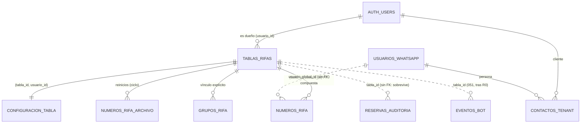
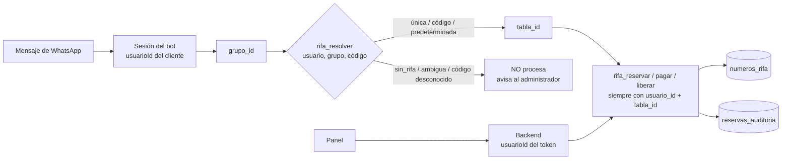

# Motor único de rifas — diagnóstico, diseño y plan

Estado: **diseño y migración preparados, NADA aplicado** (12/11/2026).
Archivos: [050_motor_rifas_centralizado.sql](../../backend/supabase_migrations/050_motor_rifas_centralizado.sql) ·
[050_revertir_motor_rifas.sql](../../backend/supabase_migrations/050_revertir_motor_rifas.sql) ·
[motorRifasSql.test.js](../../backend/tests/rifas/motorRifasSql.test.js) ·
[concurrenciaRifas.test.js](../../backend/tests/rifas/concurrenciaRifas.test.js)

Decisión del propietario (12/11): arquitectura centralizada `tablas_rifas` + `numeros_rifa`. Sustituye la «opción B» (tabla física por precio) del 06/11. La identidad de una rifa es `tabla_id` (UUID) + `usuario_id`. El precio es un dato, nunca un identificador.

---

## 1. Diagnóstico de la arquitectura actual

### 1.1 Las cuatro identidades (no confundirlas)

| Identidad | Dónde vive | Qué es |
|---|---|---|
| **Cliente del SaaS** | `auth.users.id` = `usuario_id` en casi todas las tablas | El dueño de las rifas. El panel lo obtiene del token; el bot, de la sesión (`sock.context.usuarioId`, fila de `sesiones`). |
| **Persona de WhatsApp** | `public.usuarios` (global, **compartida entre clientes**) | Comprador. Se relaciona con cada cliente a través de `contactos_tenant` (`usuario_id` + `usuario_global_id`). Tiene teléfono, LID y LIB. |
| **Grupo de WhatsApp** | `public.grupos` (por `jid`), `grupos_autorizados` (cliente ↔ grupo) | El mismo grupo puede estar en los bots de varios clientes. |
| **Sorteo / ciclo** | `eventos_bot` (una fila por grupo y sorteo), `sorteos_programados` | Un anuncio publicado. Hoy guarda `tabla` (el nombre de una tabla física) y `valor` (el precio). |

### 1.2 Cómo se elige hoy la tabla de números

```
mensaje → sesión (usuarioId) → consultarEvento(grupo, usuarioId) → evento.tabla (texto) → .from(evento.tabla)
panel   → token (usuarioId) → /tablas/:precio → tablas_cliente(usuario, precio).tabla_fisica → .from(tabla)
```

- **El precio es la identidad.** Lo es en las rutas `/tablas/:precio`, en `app/tablas/[precio]`, en la clave de `tablas_cliente (usuario_id, precio)`, en la 043 («un sorteo activo por precio») y en `configEvento.js` y `lib/tablasConfig.ts` (8 precios fijos).
- **Dos cuadrículas físicas para 8 precios.** $1.000–$2.000 van a `reservas_dos_cifras` y $3.000–$15.000 a `5k_15k_reservas_2_cifras`. Hay una fila por `(usuario_id, numero)`, así que dos precios del mismo cliente **comparten sus números** (ver `aislamientoPorPrecio.test.js`).
- **Selección arbitraria en el bot.** Si un grupo tiene dos sorteos vigentes, `consultarEvento` ([consultarEvento.js](../../backend/bot/funciones/eventos/consultarEvento.js)) devuelve el más reciente sin avisar. El motor nuevo lo prohíbe (§4).
- **El panel escribe directamente en la tabla física** ([reiniciarTabla.ts](../../frontend/services/tablas/reiniciarTabla.ts), `update` con la clave anon y RLS).
- **Trigger antiguo de pago** (`actualizar_compradores_semanales`) sobre las cuadrículas, sin versionar en el repositorio. La 034 lo envuelve. El R0 traerá su código real.
- **Auditoría:** `reservas_auditoria` (032) es la buena (inmutable, solo backend), pero podría no estar aplicada en producción. El R0 lo confirma.

### 1.3 Dependencias encontradas (código)

| Capa | Archivos que dependen de la tabla física o del precio |
|---|---|
| Resolución | `bot/funciones/eventos/configEvento.js`, `tablasCliente.js`, `reservas/filtroCliente.js`, `automation/repo/tablaEvento.js`, `frontend/lib/tablasConfig.ts`, `frontend/services/tablas/tablasCliente.ts` |
| Bot: reservas | `reservarNumeros.js`, `consultarReservas.js`, `liberacion.js`, `auditoriaReservas.js` |
| Bot: consultas | `consultarDisponibilidad.js`, `consultarNumero.js`, `consultarMisNumeros.js` |
| Bot: pagos | `marcarReservasPagadasPorAdmin.js`, `registrarStickerPago.js`, `configuracionStickerPago.js` |
| Bot: eventos | `consultarEvento.js`, `sorteoReal.js`, `detectarEvento.js`, `extraerEvento.js`, `guardarEvento.js`, `deteccion/sorteoAnterior.js`, `lifecycle/verificarEventoLleno.js`, `lifecycle/sorteoSinNumerosLibres.js` |
| Bot: otros | `usuarios/listarContactos.js`, `usuarios/obtenerPerfilContacto.js`, `inactividad/inactividadRepo.js` |
| Sorteos | `sorteos/servicio.js`, `sorteosActivos.js`, `publicador.js`, `validar.js`, `repo.js`, `disponibilidad.js`, `reinicioTabla.js`, `reservasAnticipadas.js`, `gruposSorteo.js`, `administracion.js`, `gestionEventos.js`, `capturaProgramada.js` |
| Servicios / rutas | `services/reservaManual.js` (42 referencias), `services/datosTablaImprimir.js`, `routes/tablas.js`, `automation/engine.js`, `scheduler.js`, `repo/automationConfig.js` |
| Panel | `hooks/useTablaPrecio.ts`, `hooks/useContactos.ts` (Realtime por nombre de tabla), `services/tablas/*` (obtenerTabla, reiniciarTabla, prepararCuadricula, cambiosTabla, instantaneaIndice, impactoReinicio, estadoSorteoPrecio), `components/tablas/IndiceTablas.tsx`, `types.ts`, `EventoCard`, `EventoTresCifrasCard`, `FormularioSorteo`, `VistaPreviaModal`, `EditarSorteoActivoModal`, `EditorAutomatizacion`, `ConfiguracionGrupo`, `HistorialActividad`, `automationConfigs.ts`, `PerfilContacto`, `BloqueadosPage`, `app/tablas/[precio]` |
| SQL | 002, 022, 027, 030, 033, 034, 035, 041, 043 y el trigger antiguo de pago |
| Pruebas | ~125 archivos nombran las tablas físicas |

Columnas que guardan el **nombre** de una tabla física: `eventos_bot.tabla`, `sorteos_programados.tabla`, `reservas_actividad.tabla`, `reservas_auditoria.tabla`, `reservas_archivo.tabla` (CHECK) y `tablas_cliente.tabla_fisica` (CHECK).

### 1.4 Base de datos real: pendiente del R0

El SQL de diagnóstico R0 (solo lectura) responde a lo que el código no puede decir:
- qué cuadrículas existen de verdad (incluidas `reservas_2_cifras_1000…10000` si están);
- filas por cliente;
- casos A/B/C/D de compartición;
- triggers y funciones reales;
- si la 032 está aplicada.

**El plan de migración de datos (§7) no se cierra sin esos resultados.**

---

## 2. Arquitectura nueva





Principios:
1. **Toda** lectura y escritura lleva `usuario_id` **y** `tabla_id`.
2. Solo el backend escribe, y solo a través de las funciones `rifa_*`.
3. El dueño lo decide el servidor (token o sesión), nunca el navegador ni el mensaje.

---

## 3. Esquema (migración 050)

| Tabla | Clave / restricciones | Notas |
|---|---|---|
| `tablas_rifas` | PK `id`; `UNIQUE(id, usuario_id)`; `usuario_id → auth.users ON DELETE RESTRICT`; `cantidad ≤ 10^cifras`; `codigo` único por cliente entre las vigentes | `nombre`, `codigo`, `precio`, `cifras` (1–4), `cantidad` (≤ 10.000), `activa`, `visible`, `ciclo`, `archivada_en`. **Sin unicidad por precio.** |
| `configuracion_tabla` | PK `tabla_id`; FK `(tabla_id, usuario_id)` | `config` jsonb validado: `mensajes`, `reservas{expiracion_minutos, max_por_persona, permitir_bot, permitir_panel}`, `pagos`, `sorteo`, `opciones`. Precio, cifras y cantidad **no** se duplican aquí. |
| `numeros_rifa` | PK `id`; FK `(tabla_id, usuario_id)`; `UNIQUE(tabla_id, numero)`; `numero` integer 0–9999 y `< cantidad`; libre ⇒ sin datos; pagado ⇒ `pagado_en` | Mismos datos que hoy: `comprador`, `contacto`, `telefono`, `lid`, `lib`, `usuario_global_id`, `grupo_*`, `evento_id`, `identidad_evento_real`, `origen`, `ciclo`, fechas, `version`. Índices por estado, usuario, teléfono, LID, persona y evento. |
| `numeros_rifa_archivo` | FK `(tabla_id, usuario_id) ON DELETE RESTRICT`; inmutable | Copia de cada número ocupado al reiniciar, con su ciclo. |
| `grupos_rifa` | `UNIQUE(usuario_id, grupo_id, tabla_id)`; una predeterminada por grupo | Vínculo **explícito** grupo → rifa, por cliente. |
| `reservas_auditoria` (032) | + `tabla_id`, `ciclo`; los CHECK de `accion` y `origen` **solo amplían** valores | Sin FK a propósito: la auditoría sobrevive a la rifa. |
| `rifas_resumen` (vista) | `security_invoker` | Conteos por rifa; respeta la RLS de quien consulta. |

Triggers de integridad: nadie, ni siquiera el superusuario, puede mover un número a otra rifa, cambiar el dueño de un número o de una rifa, insertar un número fuera de rango, dejar un número libre con datos ni modificar el archivo. El número se guarda como `integer`; se muestra con `lpad(numero, cifras, '0')`.

## 4. Seguridad y RLS

| Rol | tablas del motor | funciones `rifa_*` |
|---|---|---|
| `anon` | nada (permiso revocado) | nada |
| `authenticated` (panel) | **SELECT** de sus filas (`usuario_id = auth.uid()`); sin INSERT, UPDATE ni DELETE | nada |
| `service_role` (backend) | SELECT; **sin escritura directa** | EXECUTE |
| funciones `rifa_*` | escriben (SECURITY DEFINER, `search_path = ''`) | — |

- Supabase concede por defecto **todo** a anon y authenticated en las tablas nuevas de `public`; la 050 lo revoca explícitamente. La prueba simula esos permisos por defecto.
- Cada función recibe `p_usuario` y comprueba que la rifa es suya. Si no lo es, responde `rifa_no_encontrada`, lo mismo que si no existiera, para no revelar rifas ajenas.
- Funciones auxiliares en el esquema `rifas_privado`, que PostgREST no publica.
- Realtime publica `numeros_rifa` y `tablas_rifas`; los cambios llegan filtrados por la misma RLS de lectura.

## 5. Funciones transaccionales

| Función | Qué hace | Bloqueos |
|---|---|---|
| `rifa_crear` | Crea la rifa, su configuración y sus números 0..cantidad-1 | — |
| `rifa_reservar` | Reserva los libres (`p_todo_o_nada` opcional); informa no disponibles y fuera de rango | rifa FOR SHARE + números FOR UPDATE en orden |
| `rifa_pagar` | reservado/en_proceso → pagado. Un pago repetido da `ya_pagado` (no duplica). Filtro opcional de **titular** (teléfono, LID/LIB o persona) | ídem |
| `rifa_liberar` | → libre, borrando los datos. Pagados y bloqueados solo con opción explícita. Filtro de titular | ídem |
| `rifa_bloquear` | libre → bloqueado | ídem |
| `rifa_reiniciar` | Archiva los ocupados, deja todo libre y sube el ciclo. Exige `'REINICIAR'` | rifa FOR UPDATE (excluye reservas simultáneas) |
| `rifa_actualizar` | Nombre, código, activa, visible, config; precio, cifras y cantidad solo sin números ocupados | rifa FOR UPDATE |
| `rifa_archivar` / `rifa_restaurar` | «Eliminar» con historial / deshacerlo (vuelve inactiva) | rifa FOR UPDATE |
| `rifa_eliminar` | Borrado real **solo** de una rifa sin uso; si no, `tiene_historial` → archivar | rifa FOR UPDATE |
| `rifa_vincular_grupo` / `rifa_desvincular_grupo` | Configuración explícita grupo → rifa | — |
| `rifa_resolver` | Rifa de un mensaje: código → única → predeterminada; si no, `ambigua` o `sin_rifa`. **Nunca por precio, nunca al azar** | lectura |

Todas escriben en `reservas_auditoria`, en la misma transacción, una fila por número con:
- cliente, rifa (`tabla_id`) y ciclo;
- número;
- comprador y persona;
- operador u origen;
- acción y estado anterior → nuevo;
- resultado y código.

Todas devuelven `{ ok, motivo, ... }` para los casos de negocio y lanzan error solo ante datos inválidos.

## 6. Integración con WhatsApp (fase 4)

```
mensaje → usuarioId (sesión) → grupo_id
   → código en el mensaje (si el grupo tiene varias rifas, p. ej. «A 25»)
   → rifa_resolver(usuarioId, grupo_id, código)
        ok        → tabla_id → rifa_*(usuarioId, tabla_id, ...)
        no ok     → no se toca ningún número; aviso al administrador (sin_rifa / ambigua / codigo_desconocido)
```

- Los sorteos (`eventos_bot`) guardarán `tabla_id` (migración 051). Al detectar un anuncio, la rifa sale de los vínculos del grupo; el precio del anuncio **solo** puede descartar candidatas entre esos vínculos (decisión D1). Si queda 0 o más de 1, se detiene y se avisa.
- `consultarEvento` deja de devolver «el más reciente» cuando hay dos vigentes: devuelve la ambigüedad.
- Se conservan:
  - el teléfono, el LID y el LIB, que se guardan como hoy;
  - el filtro de titular, que reemplaza las comparaciones de «mis números»;
  - el sticker de pago, que llama a `rifa_pagar` con titular;
  - las notificaciones y consultas, que leen por `tabla_id`;
  - los bloqueos de contacto (`buscarBloqueo`), que siguen antes de reservar.

## 7. Plan de migración de datos (fase 6 — depende del R0)

1. **Respaldo** (con autorización): exportar a CSV las cuadrículas, `tablas_cliente`, `eventos_bot` y `sorteos_programados`, y copiarlas a un esquema `efaat_respaldo_AAAAMMDD` (`create table … as select`). Conteos de control guardados.
2. **Mapa** (migración 052): `rifas_migracion(usuario_id, tabla_legado, precio, tabla_id, caso, decision)`. Una rifa por cliente y precio configurado (`tablas_cliente`), creada con `rifa_crear`.
3. **Copia, nunca mover:**
   - **B** (un precio vigente): los ocupados van a la rifa de ese precio.
   - **A**: nada que copiar.
   - **C y D**: solo según la decisión anotada caso por caso en el mapa; sin decisión no se migra y se informa.
4. **Conversión de campos:**
   - `numero` texto → integer; los que no son dígitos se informan y no se migran.
   - `fecha_reserva`/`hora_reserva` (hora de Colombia) → `reservado_en`; lo mismo para el pago.
   - Teléfono, LID, LIB, comprador y persona se copian tal cual.
   - Cada número copiado deja una fila de auditoría `migrar`.
5. **Sorteos:** `eventos_bot.tabla_id` y `sorteos_programados.tabla_id` solo donde (cliente, tabla física, precio) apunte a **una** rifa; si es ambiguo, queda NULL y se informa. No se asignan rifas históricas por precio cuando hay ambigüedad.
6. **Verificación:** por cliente y tabla, ocupados antiguos = copiados + excluidos con motivo; pagados y reservados por separado; las cuadrículas antiguas sin cambios (md5 antes/después).

## 8. Cambio de arquitectura y retiro (fases 7 y 8)

- **Interruptor** `MOTOR_RIFAS = legado | nuevo` en el VPS y en Vercel; por defecto `legado`.
- **El cambio se hace en una ventana sin sorteos vigentes.** Se comprueba antes repitiendo la sección 14 del R0.
- **Vuelta atrás:** volver el interruptor a `legado`. Lo que se haya escrito en el motor nuevo durante la ventana se devuelve con un script preparado en la fase 7. El riesgo crece con la duración de la ventana.
- **Retiro (fase 8, con autorización):**
  1. Primero, revocar la escritura en las tablas antiguas (congelar).
  2. Después de un periodo de observación, proponer qué tablas, funciones y triggers se retiran.
  3. Nunca borrar sin autorización expresa.

## 9. Archivos que cambiarán (fases 3–5)

| Fase | Cambio |
|---|---|
| 3 Motor | Nuevo `backend/rifas/` (repositorio único: `rifas.js` = llamadas a `rifa_*` + lecturas por `tabla_id`); `routes/rifas.js` (CRUD del panel, vincular grupos); `reservaManual.js`, `routes/tablas.js` y `reinicioTabla.js` pasan a usarlo. |
| 4 Bot | Los archivos del §1.3 «Bot: …» cambian `.from(evento.tabla)` por el repositorio; `consultarEvento` deja de elegir arbitrariamente; detección de anuncios por vínculos del grupo; `configEvento.js` y `tablasCliente.js` solo quedan para el modo `legado`. |
| 5 Panel | Página «Mis rifas» (crear, editar, activar, ocultar, archivar, eliminar, vincular grupos); `app/tablas/[id]`; `useTablaPrecio` → `useRifa(tabla_id)` con Realtime en `numeros_rifa`; `useContactos` con una sola suscripción; se retiran `lib/tablasConfig.ts` y las escrituras directas. |
| SQL | 051: `tabla_id` nullable en `eventos_bot`, `sorteos_programados`, `reservas_actividad`, `reservas_archivo` y `sorteos_programados_historial`, con FK compuesta donde haya `usuario_id`; se escribe después del R0, con sus columnas reales. 052: mapa y migración de datos. |

## 10. Pruebas

| Prueba | Cómo | Resultado (12/11) |
|---|---|---|
| `motorRifasSql.test.js` | PGlite con los archivos reales 032 + 050 y los permisos por defecto de Supabase simulados | **23/23**: las 12 obligatorias más aislamiento por RLS, permisos y funciones, creación, edición, archivo, eliminación, integridad, Realtime, EXECUTE y reversión |
| `concurrenciaRifas.test.js` | Postgres 17 local desechable (puerto propio), 60–70 conexiones | **5/5 en 4 ejecuciones**, 0 interbloqueos: 60 reservas simultáneas del mismo número (gana 1), A y B a la vez, lotes cruzados, pagos dobles, reservas durante un reinicio |

```bash
PGLITE_MODULE=<carpeta>/node_modules/@electric-sql/pglite node backend/tests/rifas/motorRifasSql.test.js
PG_MODULE=<carpeta>/node_modules/pg PG_PRUEBAS_URL=postgres://postgres@127.0.0.1:<puerto>/postgres node backend/tests/rifas/concurrenciaRifas.test.js
```

`npm test` las omite (necesitan entorno) igual que las otras pruebas SQL. La de concurrencia se niega a correr contra un host que no sea local.

## 11. Riesgos

| Riesgo | Mitigación |
|---|---|
| La 032 no está en producción y la 050 la necesita | La 050 aborta con un mensaje; orden 032 → 050. El R0 lo confirma. |
| Casos C/D (cuadrícula con varios precios vigentes u ocupada sin sorteo) | No se migran sin decisión anotada; el R0 los enumera. |
| El trigger antiguo de pago (`compradores_semanales`) no existirá en `numeros_rifa` | Decisión D3 con su código real (R0, sección 04). |
| `ON DELETE RESTRICT` hacia `auth.users`: no se puede borrar un cliente con rifas | Intencional (protege el historial); hay que archivarlo antes. Decisión D4. |
| Volver a `legado` tras escribir en el motor nuevo | Ventana corta y script de devolución en la fase 7. |
| Volumen de cambios en bot y panel (~45 archivos, ~125 pruebas) | Repositorio único; cambio por fases detrás del interruptor; pruebas de caracterización antes de tocar cada flujo. |
| Rendimiento con miles de clientes | Índices por `(tabla_id, estado, numero)` y `(usuario_id, …)`; las operaciones solo tocan filas de una rifa; tope de 1000 números por operación y 10.000 por rifa. |
| `numero` texto → integer | Formato con `cifras`; los que no son dígitos quedan fuera de la migración y se informan. |

## 12. Decisiones pendientes

- **D1:** al detectar un anuncio en un grupo con varias rifas vinculadas, ¿puede el precio del anuncio descartar candidatas **dentro de esos vínculos**? (Recomendado: sí; si no queda exactamente una, se detiene y avisa.)
- **D2:** qué hacer con cada caso C/D (después del R0).
- **D3:** contadores de compradores semanales: ¿se reimplementan por cliente en `rifa_pagar` o se retiran?
- **D4:** confirmar `ON DELETE RESTRICT` de las rifas hacia `auth.users`.
- **D5:** la decisión del 12/11 («un registro por valor») queda **superada** por la prueba 8: el esquema admite varias rifas del mismo precio. El panel puede avisar, sin bloquear.
